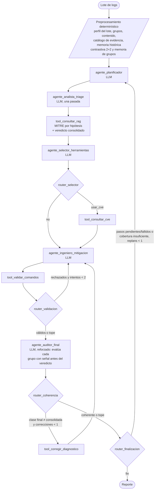

# Arquitectura de NODEX final

Rama `nodex-final` (desde el tag `piloto-12casos`). Fases A, A.1, B y B.1, con la configuración final
elegida en desarrollo el 12-nov-2026: **"B.1 sin cazador, auditor reforzado"**. El agente cazador de las
Fases B y B.1 se eliminó; los grupos con señal los evalúa el propio auditor (decisión y motivos en
`docs/experimentacion/bitacora_desarrollo_nodex_final.md`). Todos los agentes LLM usan `gemini-3.8-flash`
con temperatura 0, en la aplicación y en la evaluación (sección 6). Cada mejora tiene un interruptor en
`src/config.py`, con el valor final por omisión; con los de la Fase B apagados el grafo vuelve al de la
Fase A.

## 1. Grafo

Topes: `MAX_INTENTOS_CORRECCION = 2` (ciclo de comandos), `MAX_CORRECCIONES_AUDITOR = 1` (ciclo de
coherencia), `MAX_REPLANS = 1` (replanificación).

9 nodos: 5 agentes LLM (planificador, triage, selector, mitigación, auditor) y 4 herramientas (RAG, CVE,
validación, corrección del diagnóstico). Recorrido típico con corrección: planificador → triage → RAG →
selector → mitigación → validación → auditor → corrección → mitigación → validación → auditor.

## 2. Agentes (LLM)

| Agente | Entrada | Salida |
|---|---|---|
| `agente_planificador` | Resumen del lote | Plan: objetivo, pasos (`triage`, `rag`, `cve`, `mitigacion`) |
| `agente_analista_triage` | Resumen acotado (con `perfil_lote`), contexto de preprocesamiento, contenido del lote (líneas o flujos minoritarios), casos históricos, definiciones del criterio de la organización | `diagnostico`, `veredicto_preliminar`, `justificacion_veredicto_preliminar` |
| `agente_selector_herramientas` | Diagnóstico | `usar_cve`, `razon_seleccion` |
| `agente_ingeniero_mitigacion` | Diagnóstico, veredicto consolidado, resumen de evidencia (grupos y flujos señalados), rechazos previos | `comandos_mitigacion` (reglas por veredicto) |
| `agente_auditor_final` (reforzado) | Diagnóstico, comandos, veredicto consolidado, casos históricos, definiciones, catálogo de evidencia, tabla de grupos, candidatos MITRE; y, en un bloque destacado, los **grupos con señal** (red) o de severidad alta / plantilla minoritaria (texto) con todas sus filas, el motivo factual de la señal, el grupo malicioso y el benigno más parecidos de la memoria de grupos (red) y el comportamiento dominante del lote (`src/tools/grupos_con_senal.py`), más la lista de verificación de patrones MITRE | `evaluacion_grupos` (primer campo: por grupo con señal, explicación benigna, explicación maliciosa, `patron_lista`), `hay_anomalia`, `hay_incidente`, `confianza`, `evaluacion_auditor`, cobertura, eventos por categoría, técnicas |

Herramientas (sin LLM): `tool_consultar_rag` (técnicas MITRE con el diagnóstico como hipótesis, solo si
el veredicto del triage es un incidente, y veredicto consolidado = veredicto del triage),
`tool_consultar_cve` (NVD bloqueada en evaluación, respaldo local), `tool_validar_comandos` (validador
estricto), `tool_corregir_diagnostico` (corrección tras el auditor).

## 3. Routers

| Router | Después de | Condición | Destinos |
|---|---|---|---|
| `router_selector` | selector | `usar_cve` | `tool_consultar_cve` / `agente_ingeniero_mitigacion` |
| `router_validacion` | validación | comandos rechazados y `intentos_correccion < 2` | `agente_ingeniero_mitigacion` / `agente_auditor_final` |
| `router_coherencia` | auditor | clase del veredicto final ≠ `veredicto_consolidado` y `correcciones_auditor < 1` | `tool_corregir_diagnostico` / `router_finalizacion` |
| `router_finalizacion` | (vía coherencia) | `replan_count < 1` y (pasos pendientes o fallidos, o cobertura insuficiente) | `agente_planificador` / fin |

## 4. Campos nuevos del estado

| Campo | Tipo | Escribe | Lee |
|---|---|---|---|
| `grupos_evidencia` | lista | pipeline (M6) | auditor (`contexto_d11` y grupos con señal), `normalizar_d11` |
| `contenido_lote` | dict | pipeline (M1) | triage, auditor (grupos con señal), mitigación, agente único |
| `veredicto_preliminar`, `justificacion_veredicto_preliminar` | str | triage (M8) | consolidación, mitigación |
| `invalid_evidence_group_count` | int | auditor (M6) | salida |
| `comandos_rechazados` | lista (acumula) | validador (M7) | salida, reporte |
| `casos_historicos`, `historico_consulta` | lista, dict | pipeline (B4) | triage, auditor, agente único, RAG |
| `veredicto_consolidado` | str | RAG (veredicto del triage); corrección (B2) | mitigación, auditor, router de coherencia |
| `consulta_mitre`, `rag_omitido` | str | RAG (B3) | traza, reporte |
| `evaluacion_grupos` | lista | auditor reforzado | reporte, interfaz, PDF |
| `diagnostico_inicial`, `diagnostico_corregido`, `correcciones_auditor` | str, str, int | corrección (B2) | router de coherencia, reporte |
| `historial_correcciones` | lista (acumula) | corrección (B2) | reporte |
| `memoria_grupos`, `memoria_grupos_consulta` | dict, dict | pipeline (B.1-2) | auditor (grupos con señal), agente único, salida |

Campos retirados con el cazador: `hallazgos_cazador`, `cazador_ejecutado`, `revision_hallazgos`. Siguen en
los resultados de desarrollo de las Fases B y B.1 (`experiments/desarrollo_fase_b*`).

Salida (`campos_d11`, aditiva): además de lo anterior, `classification_detallada`
(`incidente_seguridad` / `anomalia_operativa` / `normal`, derivada del veredicto final). Los eventos
reconstruidos llevan `categoria` (`incidente` / `anomalia_operativa` / `contexto`) y `evidence_groups`.

## 5. Interruptores (`src/config.py`), valor final

| Fase | Interruptor | Valor |
|---|---|---|
| A, M1 | `CONTEXTO_LOTE_COMPLETO` / `TRIAGE_MAX_LINEAS` / `TRIAGE_MAX_CHARS` | true / 200 / 20000 |
| A, M1 | `EVIDENCIA_CONTEXTO_EXTENDIDO` / `EVIDENCIA_MAX_CHARS_MENSAJE` | true / 300 |
| A, M2 | `PERFIL_LOTE_ACTIVO` | true |
| A, M2 | `PERFIL_MIN_PUERTOS_BARRIDO` / `PERFIL_UMBRAL_MINORITARIO` / `PERFIL_PAR_RARO_MAX_FILAS` | 15 / 0,05 / 2 |
| A, M2 | `PERFIL_PERCENTIL_BYTES` / `PERFIL_MIN_FILAS_PERCENTIL` / `PERFIL_MAX_FILAS_MINORITARIAS` / `PERFIL_MAX_ORIGENES` | 95 / 20 / 60 / 20 |
| A, M2 | `UDP_S0_NO_ES_FALLO` / `BGL_ALERTA_OPCIONAL` | true / true |
| A, M6 | `EVIDENCIA_POR_GRUPOS` | true |
| A, M7 | `MITIGACION_CON_CONTEXTO` / `VALIDACION_COMANDOS_ESTRICTA` / `MITIGACION_DIR_SALIDA` | true / true / `/var/tmp/nodex` |
| A, M8 | `VEREDICTO_PRELIMINAR` | true |
| A, M9 | `UWF_REBASE_FORMATO_FONDO` | true |
| B, B2 | `CORRECCION_AUDITOR` / `MAX_CORRECCIONES_AUDITOR` | true / 1 |
| B, B3 | `RAG_POR_HIPOTESIS` | true |
| B, B4 | `HISTORICO_ACTIVO` / `HISTORICO_K` | true / 3 |
| B, B5 | `EVENTOS_POR_CATEGORIA` | true |
| B.1-1 | `HISTORICO_CONTRASTIVO` / `HISTORICO_K_POR_CLASE` | true / 2 |
| B.1-2 | `MEMORIA_GRUPOS_ACTIVA` / `MEMORIA_GRUPOS_PATH` | true / `experiments/knowledge/memoria_grupos_v1/memoria_grupos.json` |
| Final | `AUDITOR_REFORZADO` / `GRUPOS_MOTIVO_FACTUAL` / `LISTA_PATRONES_MITRE` | true / true / true |
| Final | `GRUPOS_SENAL_MAX_GRUPOS` / `GRUPOS_SENAL_MAX_FILAS` | 15 / 200 |

Interruptores retirados con el cazador: `CAZADOR_ACTIVO`, `AUDITOR_REVISA_MEDIOS` (revisión de sus
hallazgos) y `NIVELES_SOSPECHA`. Renombrados porque ahora son entrada del auditor: `CAZADOR_MOTIVO_FACTUAL`
→ `GRUPOS_MOTIVO_FACTUAL`, `CAZADOR_LISTA_PATRONES` → `LISTA_PATRONES_MITRE`, `CAZADOR_MAX_GRUPOS` /
`CAZADOR_MAX_FILAS` → `GRUPOS_SENAL_MAX_GRUPOS` / `GRUPOS_SENAL_MAX_FILAS` (mismos valores).

La memoria histórica se elige con `CHROMA_PATH` (copia del snapshot): `rag_enriquecido_30_v2` (los 30
históricos de la v1 re-indexados) o `rag_enriquecido_v2` (todos los casos de desarrollo más 8 incidentes
UWF de la v1 sin solapamiento; 56 patrones).

**Fase B.1.** La consulta de lotes es contrastiva: los 2 casos más parecidos de cada clase (normal y
anómala/maliciosa) del mismo tipo de lote, presentados como comparación y sin la similitud numérica.
La memoria de grupos (`memoria_grupos_v1`, 54 grupos de la partición de desarrollo de UWF: 12 con eventos
del incidente, etiquetados con su táctica, y 42 grupos con señal de casos benignos) describe cada grupo por
su comportamiento, sin IP; para cada grupo con señal del lote se recupera el malicioso y el benigno más
parecidos, con exclusión por solapamiento de registros. Solo logs de red. Se construye con
`python -m src.experimentation.knowledge.memoria_grupos`.

**Auditor reforzado (configuración final).** Evaluada en desarrollo como la variante "B.1 sin cazador,
auditor reforzado" (`experiments/desarrollo_fase_b1_auditor_reforzado/`). El auditor recibe, en un bloque
destacado, las filas completas de cada grupo con señal, su motivo factual, sus referentes de la memoria de
grupos y el comportamiento dominante del lote (el mismo contenido que recibía el cazador), además del
catálogo completo; la lista de verificación de patrones MITRE; y la instrucción de evaluar cada grupo con
señal (explicación benigna, explicación maliciosa, patrón de la lista) antes del veredicto, en
`evaluacion_grupos`, el primer campo de su respuesta. Un grupo sostiene un incidente solo si su
explicación benigna no es plausible con la evidencia observada. Sin grupos con señal, el auditor es el de
la Fase B sin hallazgos que revisar.

Diferencia con el prompt evaluado: se quitó toda mención al cazador. Con grupos con señal, la frase "(no
hay agente cazador: los grupos con señal los evalúas tú)" quedó en "(los grupos con señal los evalúas
tú)". Sin grupos con señal (10 de los 48 casos de desarrollo, todos BGL), el auditor evaluado todavía
recibía la instrucción de revisar hallazgos del cazador y la línea "HALLAZGOS DEL CAZADOR: ninguno"; el
final recibe solo el veredicto consolidado.

## 6. Configuración de aplicación y configuración de evaluación

El mismo código corre con dos configuraciones:

- **Aplicación** (uso normal: API, interfaz, `src/config.py` y `.env`). Los valores por omisión de
  `src/config.py`; un `.env` local puede reemplazarlos.
- **Evaluación** (corridas del experimento: campañas y arnés de desarrollo). La configuración congelada
  `experiments/config/config_oficial-12casos-r1-20261028.json` reemplaza en cada proceso hijo los
  parámetros del `.env` y de `src/config.py` (`src/experimentation/campana.py::entorno_de_la_corrida`).
  Además, cada caso corre con una copia desechable de la memoria, la red bloqueada (con registro de
  intentos) y la exclusión de patrones que comparten registros con el caso.

La **arquitectura** (interruptores de la sección 5) y el **modelo principal** son los mismos en las dos.
Difieren solo funciones de operación de la aplicación:

| Parámetro | Aplicación (`src/config.py`) | Evaluación (congelada) | Por qué difiere |
|---|---|---|---|
| `LLM_MODEL_PRIMARY` | `gemini-3.8-flash` | `gemini-3.8-flash` | No difiere (desde el 12-nov-2026; antes la aplicación usaba `gemini-3.1-pro-preview`). |
| `LLM_MODEL_FALLBACK` / `LLM_SIN_RESPALDO` | `gemini-3.6-flash` / false | `gemini-3.8-flash` / true | En la aplicación, si el principal agota sus reintentos por cuota o error transitorio, se reintenta con el respaldo para no perder el análisis. En la evaluación, cada respuesta debe venir del modelo evaluado: sin respaldo. |
| `REPUTACION_SIN_ENRIQUECIMIENTO` | false | true | La aplicación consulta la reputación externa de las IP. La evaluación no la consulta, para que el resultado no dependa de servicios externos ni de la fecha. |
| `CHROMA_PATH` | `./data/chroma` | copia por caso de `experiments/knowledge/rag_enriquecido_v2/chroma_snapshot` | La aplicación usa su memoria viva, que crece con la retroalimentación del analista. La evaluación usa una memoria congelada y desechable. |
| `IP_CACHE_PATH` | `./data/ip_reputation_cache.json` | archivo temporal por caso | Igual que la memoria: la evaluación no reutiliza estado entre casos. |
| `MEMORIA_GRUPOS_PATH` | `experiments/knowledge/memoria_grupos_v1/memoria_grupos.json` | el mismo archivo | No difiere. |

Los demás parámetros congelados (temperatura 0, modelo de embeddings `all-MiniLM-L6-v2`, topes de
recuperación y de ingesta) coinciden con los valores por omisión de la aplicación.

## 7. Qué recibe cada sistema

| | NODEX | Agente único |
|---|---|---|
| Preprocesamiento, resumen acotado con `perfil_lote` | sí | sí (misma función) |
| Contenido del lote (líneas o flujos minoritarios) | triage | sí (mismo bloque) |
| Catálogo de evidencia y tabla de grupos | auditor | sí (mismo `contexto_d11`) |
| Casos históricos (2 por clase desde B.1, misma consulta y exclusión por solapamiento) | triage y auditor | sí |
| Memoria de grupos (B.1) | auditor (en el bloque de grupos con señal) | sí (mismo bloque por grupo) |
| Grupos con señal con todas sus filas, motivo factual y lista de patrones MITRE | auditor | no (el agente único recibe el contenido del lote, como el triage) |
| Definiciones del criterio de la organización | triage y auditor | sí |
| Candidatos MITRE | por hipótesis (diagnóstico, si el triage ve un incidente), en el nodo RAG | consulta sobre el resumen del lote (la de su campaña) |
| Reglas de mitigación por veredicto y validador estricto | sí | sí (validador sin ciclo de corrección) |
| Contrato D-11 con grupos y categorías | sí | sí (mismo `PROMPT_D11`) |
| Planificador, triage y auditor separados | sí | no: una llamada |
| Evaluación explícita de cada grupo con señal antes del veredicto | sí (auditor reforzado) | no |
| Ciclos de corrección (comandos y coherencia) y replanificación | sí | no |

## 8. Pruebas por módulo (12-nov-2026)

Suite de Python: **1 591 pruebas**, 1 588 pasan; fallan 3 por el entorno de este equipo (Python 3.13 y
finales de línea del corpus enriquecido v1), sin relación con NODEX final. Frontend: **100 pruebas**
(5 archivos, vitest), todas pasan.

| Módulo | Pruebas |
|---|---:|
| `test_nodex_final_fase_a.py` (M1, M2, M6, M7, M8, M9, A.1) | 52 |
| `test_nodex_final_fase_b.py` (grupos con señal, B2-B5, grafo final, traza, ciclo de corrección extremo a extremo) | 27 |
| `test_nodex_final_fase_b1.py` (memoria contrastiva, memoria de grupos, motivo factual, lista de patrones, arnés) | 14 |
| `test_nodex_final_variante_auditor.py` (auditor reforzado, valores por omisión de la configuración elegida, interruptores en el arnés) | 6 |
| `test_output_contract_d11.py` | 26 |
| `test_llm.py` | 38 |
| `test_informe_pdf.py` | 34 |
| `test_agente_planificador.py` | 16 |
| `test_agente_auditor_final.py` | 13 |
| `test_plan_tracking.py` | 11 |
| `test_router_finalizacion.py` | 6 |
| `test_build_graph.py` | 5 |
| `test_agente_analista_triage.py` | 5 |
| `test_validation.py` | 4 |
| `test_ciclo_correccion.py` | 2 |
| `test_pipeline_plan.py` | 2 |
| Preprocesamiento (19 archivos: `test_preprocessing_*`, agregación, golden, resumen, prosa) | 292 |
| API e historial (4 archivos: `test_api_*`, `test_historial.py`) | 87 |
| Capa experimental (32 archivos en `tests/experimentation/`) | 846 |
| Resto (12 archivos: reporte, baseline, evaluación de detección, memoria, reputación, telemetría, MITRE, etc.) | 105 |
| **Total** | **1 591** |

Las pruebas del flujo de la Fase A (triage <-> RAG, grafo de 8 nodos, contrato sin categorías) siguen
activas con los interruptores de la Fase B apagados (`tests/conftest.py::modo_fase_a`).
