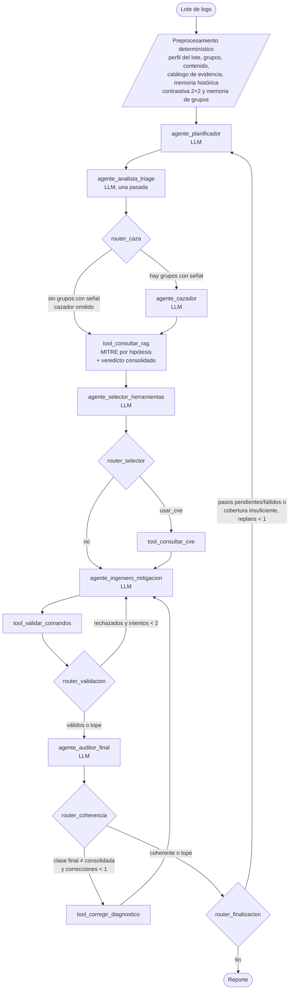

# Arquitectura de NODEX final

Rama `nodex-final` (desde el tag `piloto-12casos`). Fases A, A.1, B y B.1. Todos los agentes LLM usan
`gemini-3.8-flash` con temperatura 0 y sin modelo de respaldo (configuración de evaluación). Cada mejora
tiene un interruptor en `src/config.py`; con los de la Fase B apagados el grafo vuelve al de la Fase A.

## 1. Grafo

Topes: `MAX_INTENTOS_CORRECCION = 2` (ciclo de comandos), `MAX_CORRECCIONES_AUDITOR = 1` (ciclo de
coherencia), `MAX_REPLANS = 1` (replanificación).

## 2. Agentes (LLM)

| Agente | Entrada | Salida |
|---|---|---|
| `agente_planificador` | Resumen del lote | Plan: objetivo, pasos (`triage`, `rag`, `cve`, `mitigacion`) |
| `agente_analista_triage` | Resumen acotado (con `perfil_lote`), contexto de preprocesamiento, contenido del lote (líneas o flujos minoritarios), casos históricos, definiciones del criterio de la organización | `diagnostico`, `veredicto_preliminar`, `justificacion_veredicto_preliminar` |
| `agente_cazador` | Grupos con señal (red) o de severidad alta / plantilla minoritaria (texto), con todas sus filas y el motivo factual de la señal (B.1); por grupo de red, el grupo malicioso y el benigno más parecidos de la memoria de grupos (B.1); lista de verificación de patrones MITRE (B.1); resumen del comportamiento dominante. **No** recibe el diagnóstico del triage | `hallazgos_cazador`: por grupo, explicación benigna, explicación maliciosa u operativa, `nivel_sospecha`, `patron_lista` (B.1), justificación, técnica candidata |
| `agente_selector_herramientas` | Diagnóstico | `usar_cve`, `razon_seleccion` |
| `agente_ingeniero_mitigacion` | Diagnóstico, veredicto consolidado, resumen de evidencia (grupos y flujos señalados), hallazgos alto/medio, rechazos previos | `comandos_mitigacion` (reglas por veredicto) |
| `agente_auditor_final` | Diagnóstico, comandos, veredicto consolidado, hallazgos del cazador, casos históricos, definiciones, catálogo de evidencia, tabla de grupos, candidatos MITRE | `hay_anomalia`, `hay_incidente`, `confianza`, `evaluacion_auditor`, cobertura, eventos por categoría, técnicas, `revision_hallazgos` (cada hallazgo alto o medio confirmado o descartado; medio desde B.1) |

Herramientas (sin LLM): `tool_consultar_rag` (técnicas MITRE por hipótesis y veredicto consolidado),
`tool_consultar_cve` (NVD bloqueada en evaluación, respaldo local), `tool_validar_comandos` (validador
estricto), `tool_corregir_diagnostico` (corrección tras el auditor).

## 3. Routers

| Router | Después de | Condición | Destinos |
|---|---|---|---|
| `router_caza` | triage | `CAZADOR_ACTIVO` y hay grupos para el cazador | `agente_cazador` / `tool_consultar_rag` (omisión registrada en `historial_ejecucion`) |
| `router_selector` | selector | `usar_cve` | `tool_consultar_cve` / `agente_ingeniero_mitigacion` |
| `router_validacion` | validación | comandos rechazados y `intentos_correccion < 2` | `agente_ingeniero_mitigacion` / `agente_auditor_final` |
| `router_coherencia` | auditor | clase del veredicto final ≠ `veredicto_consolidado` y `correcciones_auditor < 1` | `tool_corregir_diagnostico` / `router_finalizacion` |
| `router_finalizacion` | (vía coherencia) | `replan_count < 1` y (pasos pendientes o fallidos, o cobertura insuficiente) | `agente_planificador` / fin |

## 4. Campos nuevos del estado

| Campo | Tipo | Escribe | Lee |
|---|---|---|---|
| `grupos_evidencia` | lista | pipeline (M6) | auditor (`contexto_d11`), cazador, `normalizar_d11` |
| `contenido_lote` | dict | pipeline (M1) | triage, cazador, mitigación, agente único |
| `veredicto_preliminar`, `justificacion_veredicto_preliminar` | str | triage (M8) | consolidación, mitigación |
| `invalid_evidence_group_count` | int | auditor (M6) | salida |
| `comandos_rechazados` | lista (acumula) | validador (M7) | salida, reporte |
| `casos_historicos`, `historico_consulta` | lista, dict | pipeline (B4) | triage, auditor, agente único, RAG |
| `hallazgos_cazador`, `cazador_ejecutado` | lista, bool | cazador (B1) | RAG, mitigación, auditor, reporte |
| `veredicto_consolidado` | str | RAG (B1); corrección (B2) | mitigación, auditor, router de coherencia |
| `consulta_mitre`, `rag_omitido` | str | RAG (B3) | traza, reporte |
| `revision_hallazgos` | lista | auditor (B1) | reporte |
| `diagnostico_inicial`, `diagnostico_corregido`, `correcciones_auditor` | str, str, int | corrección (B2) | router de coherencia, reporte |
| `historial_correcciones` | lista (acumula) | corrección (B2) | reporte |
| `memoria_grupos`, `memoria_grupos_consulta` | dict, dict | pipeline (B.1-2) | cazador, agente único, salida |

Salida (`campos_d11`, aditiva): además de lo anterior, `classification_detallada`
(`incidente_seguridad` / `anomalia_operativa` / `normal`, derivada del veredicto final). Los eventos
reconstruidos llevan `categoria` (`incidente` / `anomalia_operativa` / `contexto`) y `evidence_groups`.

## 5. Interruptores (`src/config.py`), valor final

| Fase | Interruptor | Valor |
|---|---|---|
| A, M1 | `CONTEXTO_LOTE_COMPLETO` / `TRIAGE_MAX_LINEAS` / `TRIAGE_MAX_CHARS` | true / 200 / 20000 |
| A, M1 | `EVIDENCIA_CONTEXTO_EXTENDIDO` / `EVIDENCIA_MAX_CHARS_MENSAJE` | true / 300 |
| A, M2 | `PERFIL_LOTE_ACTIVO` | true |
| A, M2 | `PERFIL_MIN_PUERTOS_BARRIDO` / `PERFIL_UMBRAL_MINORITARIO` / `PERFIL_PAR_RARO_MAX_FILAS` | 15 / 0,05 / 2 |
| A, M2 | `PERFIL_PERCENTIL_BYTES` / `PERFIL_MIN_FILAS_PERCENTIL` / `PERFIL_MAX_FILAS_MINORITARIAS` / `PERFIL_MAX_ORIGENES` | 95 / 20 / 60 / 20 |
| A, M2 | `UDP_S0_NO_ES_FALLO` / `BGL_ALERTA_OPCIONAL` | true / true |
| A, M6 | `EVIDENCIA_POR_GRUPOS` | true |
| A, M7 | `MITIGACION_CON_CONTEXTO` / `VALIDACION_COMANDOS_ESTRICTA` / `MITIGACION_DIR_SALIDA` | true / true / `/var/tmp/nodex` |
| A, M8 | `VEREDICTO_PRELIMINAR` | true |
| A, M9 | `UWF_REBASE_FORMATO_FONDO` | true |
| B, B1 | `CAZADOR_ACTIVO` / `CAZADOR_MAX_GRUPOS` / `CAZADOR_MAX_FILAS` | true / 15 / 200 |
| B, B2 | `CORRECCION_AUDITOR` / `MAX_CORRECCIONES_AUDITOR` | true / 1 |
| B, B3 | `RAG_POR_HIPOTESIS` | true |
| B, B4 | `HISTORICO_ACTIVO` / `HISTORICO_K` | true / 3 |
| B, B5 | `EVENTOS_POR_CATEGORIA` | true |
| B.1-1 | `HISTORICO_CONTRASTIVO` / `HISTORICO_K_POR_CLASE` | true / 2 |
| B.1-2 | `MEMORIA_GRUPOS_ACTIVA` / `MEMORIA_GRUPOS_PATH` | true / `experiments/knowledge/memoria_grupos_v1/memoria_grupos.json` |
| B.1-3 | `CAZADOR_MOTIVO_FACTUAL` / `CAZADOR_LISTA_PATRONES` / `AUDITOR_REVISA_MEDIOS` | true / true / true |

La memoria histórica se elige con `CHROMA_PATH` (copia del snapshot): `rag_enriquecido_30_v2` (los 30
históricos de la v1 re-indexados) o `rag_enriquecido_v2` (todos los casos de desarrollo más 8 incidentes
UWF de la v1 sin solapamiento; 56 patrones).

**Fase B.1.** La consulta de lotes es contrastiva: los 2 casos más parecidos de cada clase (normal y
anómala/maliciosa) del mismo tipo de lote, presentados como comparación y sin la similitud numérica.
La memoria de grupos (`memoria_grupos_v1`, 54 grupos de la partición de desarrollo de UWF: 12 con eventos
del incidente, etiquetados con su táctica, y 42 grupos con señal de casos benignos) describe cada grupo por
su comportamiento, sin IP; para cada grupo con señal del lote se recupera el malicioso y el benigno más
parecidos, con exclusión por solapamiento de registros. Solo logs de red. Se construye con
`python -m src.experimentation.knowledge.memoria_grupos`.

## 6. Qué recibe cada sistema

| | NODEX | Agente único |
|---|---|---|
| Preprocesamiento, resumen acotado con `perfil_lote` | sí | sí (misma función) |
| Contenido del lote (líneas o flujos minoritarios) | triage | sí (mismo bloque) |
| Catálogo de evidencia y tabla de grupos | auditor | sí (mismo `contexto_d11`) |
| Casos históricos (2 por clase desde B.1, misma consulta y exclusión por solapamiento) | triage y auditor | sí |
| Memoria de grupos (B.1) | cazador | sí (mismo bloque por grupo) |
| Motivo factual de la señal y lista de patrones (B.1) | cazador | no (son entrada del cazador) |
| Definiciones del criterio de la organización | triage y auditor | sí |
| Candidatos MITRE | por hipótesis (diagnóstico + hallazgos), en el nodo RAG | consulta sobre el resumen del lote (la de su campaña) |
| Reglas de mitigación por veredicto y validador estricto | sí | sí (validador sin ciclo de corrección) |
| Contrato D-11 con grupos y categorías | sí | sí (mismo `PROMPT_D11`) |
| Planificador, triage y auditor separados | sí | no: una llamada |
| Agente cazador | sí | no |
| Ciclos de corrección (comandos y coherencia) y replanificación | sí | no |

## 7. Pruebas por módulo (12-nov-2026)

Suite de Python: **1 593 pruebas**, 1 590 pasan; fallan 3 por el entorno de este equipo (Python 3.13 y
finales de línea del corpus enriquecido v1), sin relación con NODEX final. Frontend: **100 pruebas**
(5 archivos, vitest), todas pasan.

| Módulo | Pruebas |
|---|---:|
| `test_nodex_final_fase_a.py` (M1, M2, M6, M7, M8, M9, A.1) | 52 |
| `test_nodex_final_fase_b.py` (B1-B5, grafo, traza, ciclo de corrección extremo a extremo) | 32 |
| `test_nodex_final_fase_b1.py` (memoria contrastiva, memoria de grupos, motivo factual, lista de patrones, revisión de medios, arnés) | 17 |
| `test_output_contract_d11.py` | 26 |
| `test_llm.py` | 38 |
| `test_informe_pdf.py` | 34 |
| `test_agente_planificador.py` | 16 |
| `test_agente_auditor_final.py` | 13 |
| `test_plan_tracking.py` | 11 |
| `test_router_finalizacion.py` | 6 |
| `test_build_graph.py` | 5 |
| `test_agente_analista_triage.py` | 5 |
| `test_validation.py` | 4 |
| `test_ciclo_correccion.py` | 2 |
| `test_pipeline_plan.py` | 2 |
| Preprocesamiento (19 archivos: `test_preprocessing_*`, agregación, golden, resumen, prosa) | 292 |
| API e historial (4 archivos: `test_api_*`, `test_historial.py`) | 87 |
| Capa experimental (32 archivos en `tests/experimentation/`) | 846 |
| Resto (12 archivos: reporte, baseline, evaluación de detección, memoria, reputación, telemetría, MITRE, etc.) | 105 |
| **Total** | **1 593** |

Las pruebas del flujo de la Fase A (triage <-> RAG, grafo de 8 nodos, contrato sin categorías) siguen
activas con los interruptores de la Fase B apagados (`tests/conftest.py::modo_fase_a`).
